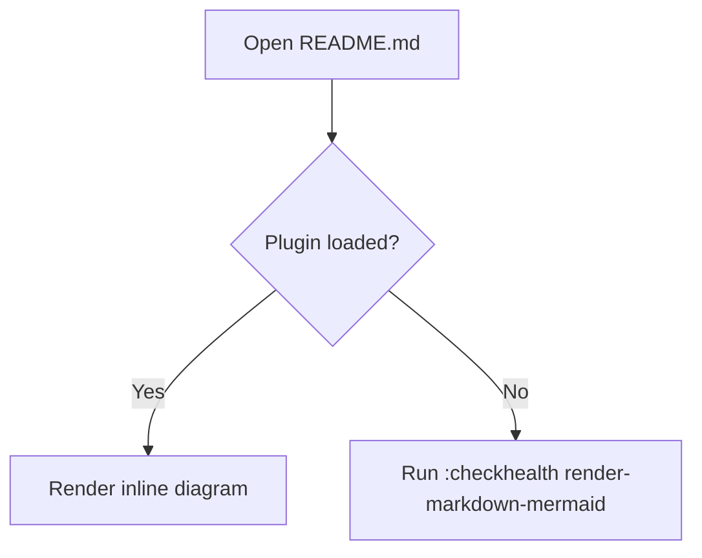
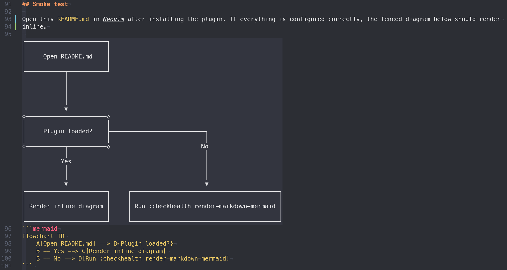

# render-markdown-mermaid.nvim

Render fenced `mermaid` code blocks inline in Neovim by combining `render-markdown.nvim` with a text renderer: `selkie` (default), Beautiful Mermaid (`bm`), `termaid`, `mermaid-ascii`, or `merman-cli` (experimental).
The default setup attaches to both Markdown and MDX buffers.

## Requirements

- Neovim `0.10+`
- [`nvim-treesitter`](https://github.com/nvim-treesitter/nvim-treesitter) with `markdown` and `markdown_inline` parsers
- [`render-markdown.nvim`](https://github.com/MeanderingProgrammer/render-markdown.nvim)
- `selkie` in your `PATH` (default renderer), or `bm` / `termaid` / `mermaid-ascii`; `merman-cli` works as an opt-in override

## Install a renderer

This plugin shells out to an external Mermaid CLI. Install one of these and make sure the executable is on your `PATH`.

`selkie` is the default backend — a native Rust renderer with the fastest renders and the broadest diagrammatic
character-art coverage. `bm` is a high-quality Node.js renderer (slower per render, narrower coverage), `termaid` is a
Python renderer with broad support and a pipe-friendly CLI, and `mermaid-ascii` is a lightweight fallback. `merman-cli`
is an opt-in backend for window-width fitting.

Approximate warm-render cost on a small mixed corpus: `selkie` ~2 ms, `mermaid-ascii` ~4 ms, `merman-cli` ~4 ms,
`termaid` ~50 ms, `bm` ~120 ms (Node.js startup dominates).

### Default: `selkie`

[`selkie`](https://github.com/btucker/selkie) is a native Rust implementation of Mermaid with the fastest renders and
the broadest diagrammatic character-art coverage of the supported backends (circular pies, radar, treemap, sankey,
kanban, ...). It always draws with Unicode box-drawing characters (no plain-ASCII mode) and has no padding flags, so
`mode` and `cli` padding do not apply to it, and it is under active development.

```bash
cargo install selkie-rs
```

### Alternative: `bm`

`bm` is provided by [`beautiful-mermaid-cli`](https://www.npmjs.com/package/beautiful-mermaid-cli), which uses the
[`beautiful-mermaid`](https://github.com/lukilabs/beautiful-mermaid) renderer.

```bash
# npm
npm i -g beautiful-mermaid-cli

# Bun
bun add -g beautiful-mermaid-cli

# Homebrew
brew install okooo5km/tap/bm
```

### Alternative: `termaid`

`termaid` is available on PyPI and reads Mermaid source from stdin or a file. Install it with:

```bash
pip install termaid
```

### Fallback: `mermaid-ascii`

`mermaid-ascii` is available on npm at [`mermaid-ascii`](https://www.npmjs.com/package/mermaid-ascii), but it supports a smaller subset of
Mermaid syntax than `bm`.

```bash
# npm
npm i -g mermaid-ascii

# Homebrew
brew install cavanaug/tap-extras/mermaid-ascii
```

#### pgavlin's fork (broader coverage)

[`pgavlin/mermaid-ascii`](https://github.com/pgavlin/mermaid-ascii) is a drop-in Go fork with the same `mermaid-ascii`
binary name and flags — the plugin uses it unchanged — but it renders many more diagram types (pie, gantt, mindmap,
timeline, git graph, and more) in a few milliseconds:

```bash
go install github.com/pgavlin/mermaid-ascii@latest
```

Caveat: the fork currently drops `A -- text --> B` edge labels along with the nodes they point to, while still exiting
with code 0. Write those edges as `A -->|text| B` while using it.

### Experimental: `merman-cli`

[`merman-cli`](https://github.com/Latias94/merman) is a native Rust Mermaid implementation whose value for Neovim is
window-width handling: flowcharts and sequence diagrams retry with a compact layout, and anything that still does not
fit falls back to a structured text report instead of overflowing the window. Opt in with:

```lua
opts = { cmd = { 'merman-cli' } }
```

```bash
cargo binstall merman-cli
# or: brew install merman-cli
```

When selected, `width` defaults to `'auto'` (see [Options](#options)). Flowchart, sequence, state, class, ER, and XY
chart diagrams render as character-art diagrams; gantt, git graph, journey, kanban, mindmap, packet, and timeline
render as structured text reports; other families (pie, radar, sankey, treemap, ...) have no ASCII output and surface
the renderer's error. Structured text reports and width fallbacks are prefixed with a notice line so they are clearly
distinguishable from diagrams.

After installing a renderer, restart Neovim or ensure your shell `PATH` is visible to Neovim, then run:

```vim
:checkhealth render-markdown-mermaid
```

## Install with lazy.nvim

This plugin can set up `render-markdown.nvim` for you, so the default install is just one block:

```lua
{
    'cavanaug/render-markdown-mermaid.nvim',
    dependencies = {
        'nvim-treesitter/nvim-treesitter',
        'MeanderingProgrammer/render-markdown.nvim',
    },
    build = ':TSUpdate markdown markdown_inline',
    opts = {},
}
```

If you want custom options, put them in that same `opts` table:

```lua
{
    'cavanaug/render-markdown-mermaid.nvim',
    dependencies = {
        'nvim-treesitter/nvim-treesitter',
        'MeanderingProgrammer/render-markdown.nvim',
    },
    build = ':TSUpdate markdown markdown_inline',
    opts = {
        placement = 'below',
        mode = 'ascii',
        render_markdown = {
            code = { border = 'thin' },
        },
    },
}
```

## Smoke test

Open this `README.md` in Neovim after installing the plugin. If everything is configured correctly, the fenced diagram below should render
inline.

### Mermaid Inline/Source



### Mermaid PNG Render



## Options

```lua
{
    mode = 'unicode', -- default: Unicode box-drawing; use 'ascii' for ASCII fallback
    placement = 'above', -- render above or below the raw mermaid fence while editing
    replace = false, -- visually replace the fence in normal mode when not editing that block
    cmd = { 'selkie' }, -- resolved command; omit cmd to prefer selkie, then bm, then termaid, then mermaid-ascii
    width = nil, -- nil | 'auto' | number: window-width fitting (merman-cli; defaults to 'auto' when selected)
    auto_setup_render_markdown = true,
    debounce = 150,
    timeout = 2000,
    cache = true,
    hide_source = false,
    max_block_lines = 200,
    max_preview_lines = '75%', -- percentage of window height; number of rows, or false for unlimited
    center = true, -- horizontally center diagrams that fit in the available text area
    focus_key = '<CR>', -- Enter on a Mermaid block opens navigation; false disables the shortcut
    render_markdown = {
        file_types = { 'markdown', 'mdx', 'markdown.mdx' },
    },
    cli = {
        border_padding = 1,
        padding_x = 5,
        padding_y = 5,
    },
}
```

`placement` controls whether the rendered diagram is shown `above` or `below` the raw mermaid fence while editing. The default is `above`.

`replace = true` visually replaces the raw mermaid fence in normal mode whenever your cursor is outside that block. Entering that block or
entering insert mode reveals the source again and falls back to `placement`.

`mode` controls whether text renderers use Unicode box-drawing characters (`unicode`) or plain ASCII fallback characters (`ascii`). The
default is `unicode`.

If you do not set `cmd`, the plugin prefers `selkie`, then `bm`, then `termaid`, and falls back to `mermaid-ascii`.
When `mode = 'ascii'` is set, an ASCII-capable backend (`bm`, then `termaid`, then `mermaid-ascii`) is preferred
instead, since `selkie` always renders with Unicode box-drawing characters.

`width` enables window-width fitting for renderers that support it (currently `merman-cli`). `'auto'` uses the width of
the window showing the buffer minus the sign/number columns; a number fixes the column budget. When `cmd` is
`merman-cli`, `width` defaults to `'auto'`: flowcharts and sequences retry a compact layout, and diagrams that still
exceed the width fall back to a structured text report. Structured text output and fallback reports are prefixed with a
notice line (highlighted with `RenderMarkdownMermaidNotice`, text configurable via `ui.report` and `ui.fallback`) so
they are distinguishable from diagrams. Set `width = false` to opt out of width fitting while using `merman-cli`.

`hide_source = true` will conceal the raw mermaid fence whenever your cursor is outside that fence, leaving the rendered diagram visible.

## Scrolling tall diagrams

Tall diagrams render in a bounded inline viewport instead of consuming the whole page. By default,
`max_preview_lines = '75%'` allows up to 75% of the window height for diagram rows and recalculates on resize.
Use a percentage string such as `'50%'` or `'90%'` (greater than 0 and at most 100). A few rows are always reserved
for the header and source anchor. Existing positive integers still set a fixed row budget, `false` restores unlimited
inline output, and legacy `'auto'` resolves to the new `'75%'` default. Small diagrams are unchanged.

`center = true` horizontally centers diagrams in the available text area, excluding number/sign columns. The same
padding is applied to every row and based on the widest row of the full diagram, so the layout stays aligned while
scrolling. The focused view keeps that alignment without adding spaces to the rendered text you copy. Diagrams
wider than the window remain left-aligned for horizontal scrolling. Set `center = false` for the original left alignment.
The diagram background extends to the right edge of the text area, including short and empty rows.

1. Place your cursor on the Mermaid source fence or the real line anchoring its inline preview.
2. Press **Enter** once to put the real cursor inside the rendered diagram. No command is required.
3. Navigate using ordinary Vim motions:

| Keys | Action |
| --- | --- |
| `h` / `j` / `k` / `l`, `w` / `b`, `f`, counts | Move through the rendered text normally |
| `Ctrl-d` / `Ctrl-u`, `Ctrl-f` / `Ctrl-b`, mouse wheel | Native window scrolling |
| `gg` / `G` | First / last rendered line |
| `/`, `?`, `n` / `N` | Search the rendered diagram |
| Visual selection, `y`, `yy` | Select and copy rendered text |
| `Tab` / `Shift-Tab` | Next / previous installed rendering engine |
| `q` or `Esc` in Normal mode, or `:MermaidFocus` again | Leave diagram focus |

A header shows the visible row range, total rows, and whether diagram focus is active. Focus uses a borderless,
read-only scratch buffer positioned over the inline preview: the cursor moves through real rendered lines, not the
Markdown source. This also works for small diagrams when you want to select or copy their output. Wide diagrams
do not wrap and support native horizontal scrolling.

Only exit (`q`/`Esc`) and engine-cycle (`Tab`/`Shift-Tab`) keys are mapped in the scratch buffer; movement keys remain native. The source-buffer Enter shortcut
opens navigation only on a rendered Mermaid block/preview anchor; elsewhere it preserves the existing Enter mapping
or native Vim behavior. Exiting restores the source cursor and window view and wipes the temporary buffer. Switching to
another buffer/window, closing the viewer, or editing/removing its source fence also releases focus. Navigation does
not rerun the renderer or modify the Markdown file.

Each fence retains its own diagram cursor and scroll position until the buffer text changes. Inactive virtual lines are
shared between windows showing the same buffer, so their scroll position is shared too; the viewport fits the smallest
of those windows. Resizing updates the row budget and keeps a focused viewport visible. Renderer notices remain
visible above the diagram. With `max_preview_lines = false`, focused navigation still uses a screen-sized window.

Set `focus_key` to another key to change the shortcut, or `false` to disable it and restore the original mapping:

```lua
opts = { focus_key = '<Tab>' } -- default: '<CR>' (Enter)
```

`:MermaidFocus` remains available as an optional command.

Try `samples/tall.md` for a scrolling smoke test.

## Switching rendering engines

While navigating a diagram, press **Tab** to try the next installed backend or **Shift-Tab** for the previous one.
The diagram reopens with the new output, and its header shows the selected engine. Your Markdown-source Tab mapping
is unchanged. Moving elsewhere while a slow backend renders cancels automatic re-entry into diagram navigation.

You can also run `:MermaidCycle` from any buffer; `:MermaidCycle!` cycles backwards. The cycle order is:
`selkie` → `bm` → `termaid` → `mermaid-ascii` → `merman-cli` → back to `selkie`, skipping missing executables.
The selection is session-wide: loaded Markdown/MDX previews are refreshed, but your saved configuration is not changed.
Cached output is reused when switching back. Custom command paths/wrappers supplied in `cmd` are retained when returning
to their backend, and explicit width settings are preserved; Merman enables automatic width fitting when width was unset.

Cycling changes the backend, not its supported diagram types: a backend that cannot render the current diagram shows
its usual render error. Selkie still emits Unicode even with `mode = 'ascii'`. Merman may emit structured text rather
than a diagram, as described above.

Optional shortcuts outside the diagram viewer:

```lua
vim.keymap.set('n', '<leader>mc', '<Plug>(MermaidCycle)', { desc = 'Next Mermaid renderer' })
vim.keymap.set('n', '<leader>mC', '<Plug>(MermaidCycleBack)', { desc = 'Previous Mermaid renderer' })
```

## Health check

Run:

```vim
:checkhealth render-markdown-mermaid
```

This checks for:

- `render-markdown.nvim`
- `selkie`
- `bm`
- `termaid`
- `mermaid-ascii`
- `merman-cli` (opt-in renderer)
- which renderer will be selected by default
- treesitter parsers for `markdown` and `markdown_inline`
- a modern enough Neovim / treesitter runtime

`render-markdown.nvim` may still show optional warnings for LaTeX support if you do not have the `latex` parser or a converter like `utftex`
/ `latex2text` installed. Those warnings are only relevant if you want LaTeX rendering in markdown.
