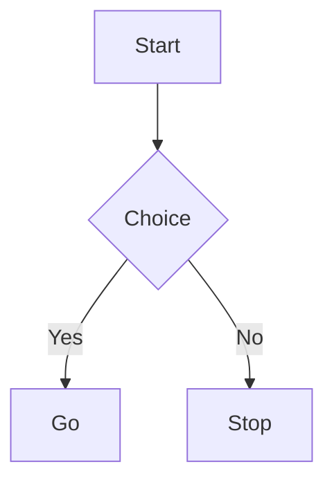

# Renderer comparison: performance, capabilities, and output quality

Historical reference from the initial backend evaluation on **2026-10-25**.
Documented on **2026-10-26** from the saved benchmark results and follow-up output inspections.
These are observations for the versions below, not guarantees about newer releases.

## Recommendations

- **Selkie is the default for speed and broad text-rendering coverage.** It was the fastest overall in this
  experiment, but its Unicode boxes and braille/dotted routing look different from bm's output.
- **Choose bm if you prefer its box-and-line appearance.** It rendered the common graph families well in
  this corpus, but had higher per-process latency and rejected the Gantt, pie, and mindmap fixtures.
- **Choose termaid for broad coverage with a different presentation style.** Its timings were between
  the native binaries and bm; all eleven fixtures produced output.
- **pgavlin's mermaid-ascii fork is a fast, drop-in coverage expansion**, but a confirmed silent parsing
  gap with `A -- text --> B` makes output inspection important. Use `A -->|text| B` for those edges.
- **Choose Merman when explicit width handling matters.** Compact retries and structured fallbacks can
  fit a narrow window without cropping fields, but a fallback report is not equivalent to a diagram and
  can consume many more rows.

**Count readable, correct output alongside milliseconds.** A circular pie, routed graph, bar summary, and
structured model report do not represent the same rendering task. An exit code of zero is not proof that
the diagram is complete.

## Backends and versions

| Backend | Evaluated version | Runtime / character of output |
| --- | --- | --- |
| [Selkie](https://github.com/btucker/selkie) | `selkie 0.3.0` (`selkie-rs`) | Native Rust; Unicode boxes and braille routing; dedicated text renderers for many diagram families |
| [Beautiful Mermaid CLI](https://www.npmjs.com/package/beautiful-mermaid-cli) | `bm 0.2.4` | Node.js; uses [beautiful-mermaid](https://github.com/lukilabs/beautiful-mermaid); conventional box-and-line output |
| [termaid](https://pypi.org/project/termaid/) | `termaid 0.9.1` | Python; broad text coverage, including chart/timeline presentations |
| [pgavlin/mermaid-ascii](https://github.com/pgavlin/mermaid-ascii/tree/ab8074a98bef86a951c3443910363a8d1415135b) | `ab8074a98bef86a951c3443910363a8d1415135b` | Native Go fork; same executable name and argument contract as the existing adapter |
| [Merman](https://github.com/Latias94/merman) | `merman-cli 0.9.2` | Native Rust; diagrammatic and structured-text projections with explicit viewport contracts |

The plugin also accepts the original [AlexanderGrooff/mermaid-ascii](https://github.com/AlexanderGrooff/mermaid-ascii).
**It was not separately benchmarked here. Every mermaid-ascii timing below refers to pgavlin's fork.**
The plugin cannot distinguish these implementations just from the shared executable name. Their feature
sets and optional flags should not be assumed identical; the tested pgavlin revision had no `--max-width` flag.

## Benchmark method and limits

- One Linux x86_64 workstation; no cross-machine or cross-platform normalization. CPU details and runtime
  versions beyond the renderer versions above were not captured in the benchmark artifact.
- Eleven inputs covering eight families: three flowcharts, two sequences, class, state, ER, Gantt, pie,
  and mindmap. The larger flowchart contained **21 nodes**: a chain of 16 plus five side-task nodes.
- One warmup invocation per backend/input, followed by **seven timed subprocess invocations**. Timings
  are wall-clock medians in milliseconds and include process startup, stdin/stdout handling, and rendering.
  Warm means filesystem/runtime caches were warmed, **not** that a renderer process stayed alive.
- Backend groups ran sequentially, not in a randomized order. This was an exploratory comparison, not
  a controlled performance study or a large-diagram stress test.
- Source was piped through stdin; output was captured rather than displayed in an interactive terminal.
  The text modes were Unicode-oriented, even when a CLI called its format `ascii`.
- Selkie's executable was resolved with `mise which selkie` before timing, avoiding its tool-manager shim.
  Other commands were invoked through their available CLI entrypoints.
- The harness allowed ten seconds per invocation. None of the successful per-case medians exceeded
  the plugin's default two-second renderer timeout.
- These numbers exclude the plugin's debounce delay, cache hits, extmark work, centering, and navigation.
  Runtime startup contributes to the figures; its share was not separately profiled.
- Output checks were deliberately simple: successful exit, nonempty output, and selected label tokens.
  They were not semantic graph comparisons or comprehensive readability scores.

### Baseline invocations

Each command below read the same Mermaid source from stdin:

```sh
bm ascii --box-padding 1 --padding-x 5 --padding-y 5
termaid --padding-x 5 --padding-y 5
mermaid-ascii -f - -p 1 -x 5 -y 5
selkie -i - -e ascii -o -
merman-cli render - --format unicode --output - --ascii-color plain
```

These preserve the original experiment, not every argument used by the current plugin. In particular,
the Merman baseline had **no width constraint** and did **not** use `--ascii-report`. The current adapter
requests the JSON report envelope and normally supplies a window-width budget; its cost and emitted
projection can therefore differ from the baseline table.

## Measured render times

Median milliseconds, seven timed runs after one warmup. **Error** means the fixture was rejected;
the time spent returning an error is not presented as a successful render time.

| Fixture | bm | termaid | mermaid-ascii fork | Selkie | Merman baseline |
| --- | ---: | ---: | ---: | ---: | ---: |
| README flowchart: decision and labeled branches | 125.1 | 50.6 | 4.8† | 3.8 | 4.7 |
| Left-to-right alignment flowchart: six nodes | 122.6 | 51.0 | 5.0 | 3.7 | 4.2 |
| Larger top-down flowchart: 21 nodes | 141.0 | 52.2 | 11.2 | 5.0 | 9.1 |
| Sequence: three participants, forwarded message | 118.1 | 52.1 | 4.2 | 1.0 | 3.8 |
| Sequence: six messages, mixed arrow types | 118.0 | 51.8 | 4.5 | 1.0 | 3.6 |
| Class: Animal, Duck, Fish, Zebra | 118.6 | 53.8 | 4.5 | 1.5 | 3.8 |
| State: Still, Moving, Crash | 121.6 | 59.5 | 4.3 | 1.7 | 4.4 |
| ER: customers, orders, line items, addresses | 117.1 | 51.6 | 4.1 | 1.6 | 3.6 |
| Gantt: two sections, three tasks | Error | 52.1 | 4.4 | 1.4 | 3.6‡ |
| Pie: four project-distribution categories | Error | 50.3 | 4.3 | 3.0 | Error |
| Mindmap: root with two branches | Error | 50.5 | 4.5 | 5.9 | 3.7‡ |
| **Median of successful per-fixture medians** | **120.1** | **51.8** | **4.5** | **1.7** | **3.8** |
| **Fixtures with exit 0 and nonempty output** | **8/11** | **11/11** | **11/11†** | **11/11** | **10/11** |

† The fork silently omitted branch targets in the README flowchart; its fast result was **incomplete**.
‡ Merman emitted structured text, not Gantt chart geometry or a two-dimensional mindmap.

The aggregate row excludes errors, so each backend's median may summarize a different subset. Use the
individual fixtures for like-for-like timing comparisons. Selkie was not fastest on every fixture:
the small mindmap was faster with Merman or the Go fork.

## Capabilities and presentation

This table combines inspected output and upstream descriptions consulted during the evaluation.
Only the eight families in the timing table were exercised by the benchmark. Broader coverage below
is **documented upstream coverage**, not a claim that this experiment tested every syntax variation.

| Backend | Coverage and visual tradeoffs | Plain ASCII / spacing | Width handling in this plugin |
| --- | --- | --- | --- |
| Selkie | Broad native text rendering; upstream described 22 supported families, including architecture, radar, Sankey, block, C4, packet, Kanban, and treemap. A circular shaded pie was observed; mindmap was an outline. Braille routing differs visibly from bm. | No plain-ASCII switch or CLI padding flags in the evaluated version; plugin `mode` and `cli` padding do not apply. | No renderer-side width budget wired by the adapter. |
| bm | Observed flowchart, sequence, class, state, and ER output. Evaluated CLI rejected Gantt, pie, and mindmap headers. Useful when its box-and-line style is preferred. | Unicode or `--ascii`; box padding and horizontal/vertical spacing are passed through. | No renderer-side width budget wired by the adapter. |
| termaid | All benchmark fixtures produced output. Gantt had timeline bars; pie was a compact bar/percentage presentation rather than a circle. | Unicode or `--ascii`; horizontal/vertical spacing are passed through. | No renderer-side width budget wired by the adapter. |
| mermaid-ascii fork | Broad native text coverage advertised as 22 types. Observed pie was horizontal bars; mindmap retained literal `root((Bench))` syntax. Silent edge-syntax omission is a correctness caveat. | Unicode or `-a`; border and horizontal/vertical spacing are passed through. | No width flag in the tested fork; none is passed by the adapter. |
| Merman | Documented diagrammatic families: flowchart, sequence, state, class, ER, XY chart. Structured-text families include Gantt, GitGraph, journey, Kanban, mindmap, packet, timeline, TreeView. Pie, architecture, radar, Sankey, treemap, and other SVG-capable families are not necessarily text targets. | Unicode or ASCII output formats. The adapter does not translate generic `cli` padding to Merman-specific flags. | Explicit maximum width, compact retry for flowchart/sequence, and structured fallback when still too wide. |

Text support and SVG support are separate capabilities. For example, being able to render a Merman pie
to SVG does not mean `--format unicode` can render it.

## Readability, footprint, and correctness findings

### A smaller result is not automatically a better result

The original harness recorded rows × maximum line length. Width was Python's `len(line)`, **not terminal
display-cell width**, so these are rough footprint comparisons rather than precise Unicode layout metrics.
Leading/trailing whitespace was stripped from the overall output before measuring; internal blank rows
and line padding could remain.

| Fixture | bm | termaid | mermaid-ascii fork | Selkie | Merman baseline |
| --- | ---: | ---: | ---: | ---: | ---: |
| Larger top-down flowchart | 155 × 27 | 173 × 32 | 155 × 27 | 99 × 31 | 155 × 68 |
| Three-participant sequence | 16 × 47 | 10 × 51 | 13 × 37 | 14 × 69 | 13 × 41 |
| Pie | Error | 8 × 53 | 6 × 63 | 23 × 36 | Error |

Selkie's pie used more rows because it actually drew a circular shaded chart and legend. The Go fork
and termaid used bar/percentage summaries. The tall flowchart and wide sequence also illustrate why
height and width should be evaluated separately; one renderer is not uniformly more compact.

### The fork's silent edge omission

With the tested pgavlin revision, the README's style of labeled branch:



produced only the start/decision portion and still exited successfully. Rewriting the edges as
`B -->|Yes| C[Go]` and `B -->|No| D[Stop]` preserved the destinations in follow-up inspection.
This is a version-specific finding, not a claim about every mermaid-ascii implementation.

### The Gantt label check was too strict for chart output

The harness searched for both the section label `Team` and the internal task ID `a1`. Selkie, termaid,
and the Go fork drew task names and timeline bars but did not print that ID, so they received a
`labels_ok = false` flag. Merman's structured report retained it.

That flag does **not** establish missing task names or broken Gantt geometry. Conversely, retaining
`a1` in a model report does not make that report a more faithful visual chart. A better future test
would separately check task names, dates/dependencies, and spatial readability.

## Merman width experiment: diagrams versus reports

The initial 80-column experiment added:

```sh
--ascii-max-width 80 --ascii-layout-profile auto --ascii-overflow fallback
```

This exploratory invocation applied `auto` to every fixture. It rejected class, state, ER, Gantt, and
mindmap with `layout_profile ... is not admitted for this diagram family`. Those failures were an
**argument-selection error**, not evidence that the families lacked text output.

The plugin adapter accounts for this: it requests the `auto` layout profile only for flowcharts and
sequences, while other families can still use the width and overflow flags with their canonical profile.
Follow-up probes confirmed width/fallback operation without `auto` for state and Gantt.

An important footprint example from the measured 80-column experiment:

| Six-node left-to-right flowchart | Median | Rows × approximate columns | Projection |
| --- | ---: | ---: | --- |
| Merman baseline, no width budget | 4.2 ms | 5 × 100 | Diagram |
| Merman, 80-column budget with fallback | 5.3 ms | 218 × 43 | Structured model report |

The fallback retained the labels and fit the width but expanded to hundreds of rows. It should not
be counted as a compact ASCII graph or presented as a pure rendering-performance win.

Follow-up Neovim smoke testing also found a positive case: the README flowchart fit as a diagram in
a 60-column window with compact retry, without requiring a structured fallback. Neither observation
guarantees that arbitrary diagrams can fit arbitrary widths.

The current plugin uses `--ascii-report` to distinguish the outcomes. Its JSON envelope carries the
rendered `text`, `projection` (`diagrammatic` or `structured_text`), `outcome` (`primary` or `fallback`),
and viewport metadata. Structured primary output and width fallbacks receive different notice lines.

## What this means for the plugin

- Default auto-selection is **Selkie → bm → termaid → mermaid-ascii**. With explicit `mode = 'ascii'`,
  ASCII-capable backends are preferred. Merman is selectable explicitly or through renderer cycling.
- Choose an engine with `opts = { cmd = { 'bm' } }`, for example. Inside diagram navigation, **Tab /
  Shift-Tab** compares installed engines; `:MermaidCycle[!]` also changes the session-wide selection.
- No automatic per-diagram backend fallback is implied by that priority. Once selected, an engine
  that cannot render a diagram reports a render failure rather than silently choosing another.
- Inline height limits, centering, and native Vim navigation handle presentation after rendering.
  They do not change the engine's layout or turn a structured report into a diagram.
- Cached results make revisiting an engine cheaper than its subprocess timings suggest. Cycling is
  useful for comparing **appearance and correctness**, not for timing the renderer interactively.

## Sources and future comparisons

Primary upstream references consulted for the original evaluation:

- [Selkie README](https://github.com/btucker/selkie) and
  [text-rendering module documentation](https://docs.rs/selkie-rs/0.3.0/selkie/render/ascii/index.html).
- [Beautiful Mermaid CLI](https://www.npmjs.com/package/beautiful-mermaid-cli) and
  [beautiful-mermaid](https://github.com/lukilabs/beautiful-mermaid).
- [termaid package](https://pypi.org/project/termaid/0.9.1/).
- [pgavlin fork at the evaluated revision](https://github.com/pgavlin/mermaid-ascii/tree/ab8074a98bef86a951c3443910363a8d1415135b).
- [Merman CLI guide](https://github.com/Latias94/merman/blob/v0.9.2/crates/merman-cli/README.md) and
  [ASCII support matrix](https://github.com/Latias94/merman/blob/v0.9.2/docs/rendering/ASCII_SUPPORT_MATRIX.md).

This document preserves the earlier experiment; the figures have **not** been rerun for this document.
The original runner, corpus, and raw captures were temporary evaluation artifacts, not a maintained
benchmark suite in this repository. For a future repeatable benchmark, commit the exact fixture corpus
and runner, pin binary/library/runtime versions, record host details, and save raw timing/output data.
Measure the current adapter's actual arguments, including Merman report/width handling. Score semantic
retention, routing/readability, and rows/display-cell widths separately from latency and exit status.
