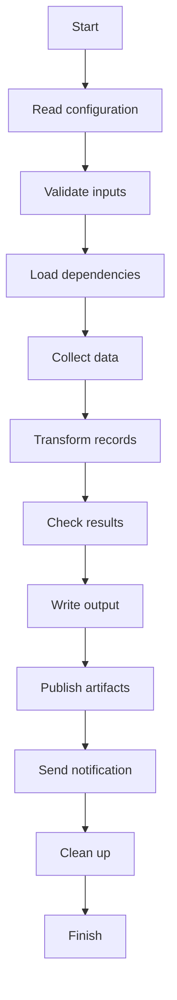

# Tall diagram scrolling

Place the cursor on the Mermaid fence and press Enter once. Use normal Vim
motions, `/` to search, or visual selection and `y` to copy rendered text.
Press `q` or `Esc` in Normal mode to return to the Markdown source.

This paragraph stays part of the Markdown document. Scrolling the diagram does
not move the source cursor or modify this file.
